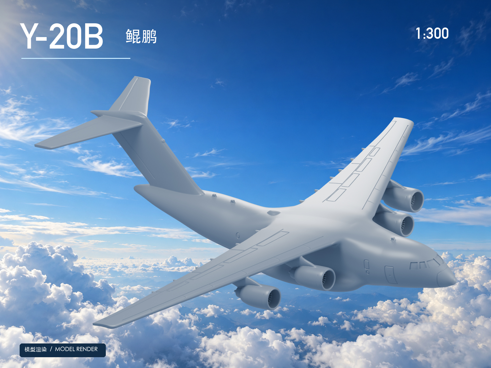

# 文水十三维工坊

**Wenshuishi 3D Atelier**

从观察到造型，从细节到整体。

文水十的 3D 作品集 · 模型设计 · 渲染展示 · 制作记录

[浏览作品](#作品) · [制作理念](#制作理念) · [关于作者](#关于作者)

文水十作品 · 数字模型渲染

## 作品

### 001 · Y-20B 鲲鹏

**航空模型 / 1:300 / 数字模型与渲染展示**

把大型运输机的体量感收进掌心：四台发动机、宽阔主翼与 T 形尾翼，以及反复调整的翼身过渡与驾驶舱细节。

[查看作品介绍与完整图集 →](works/y-20b/README.md)

---

## 制作理念

- **先看整体，再看细节。** 以实物图片和多角度参照校正轮廓，再逐步处理窗框、刻线和连接处。
- **兼顾外观与小比例制作。** 让细节服务于模型的识别度，并结合打印尺寸考虑厚度与强度。
- **记录有意义的变化。** 用清楚的前后对比呈现调整，区分数字验证和实际打印结果。

## 关于作者

**Wenshuishi · 文水十**

这里持续收录我的 3D 作品、展示图与制作过程。各件作品拥有独立介绍页，未来的新作品也会在这里更新。

[GitHub 主页](https://github.com/Wenshuishi0528) · [作品集更新](CHANGELOG.md) · [展示与使用说明](NOTICE.md)

本仓库仅收录展示图片与文字介绍，不提供模型或工程文件下载。图片标注为渲染时，均非实物照片。
