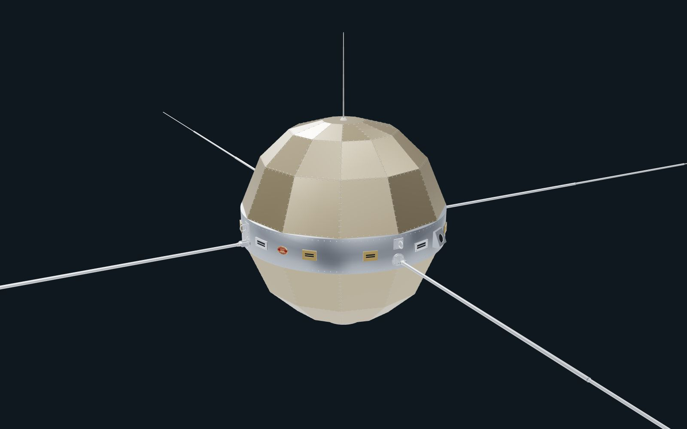
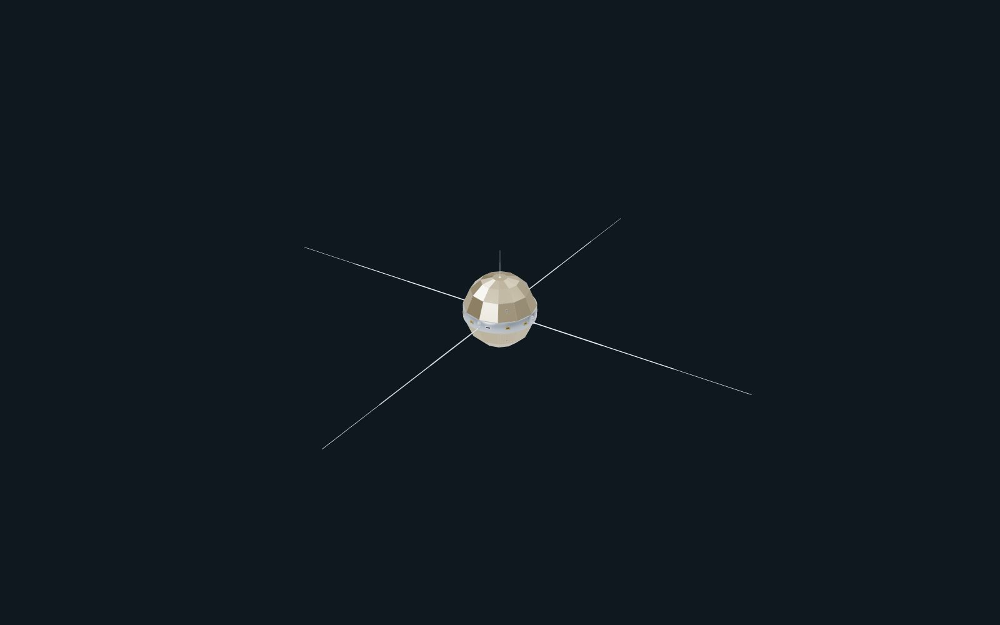
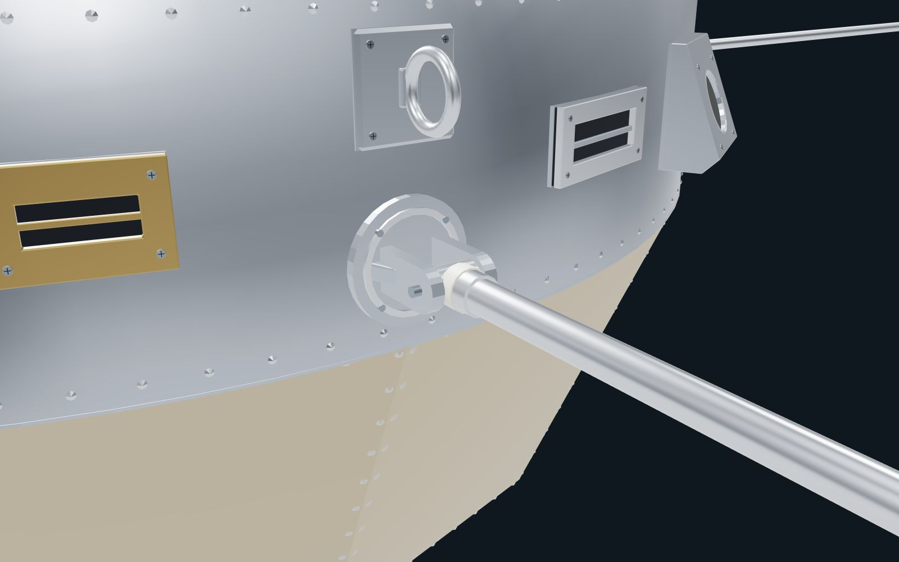
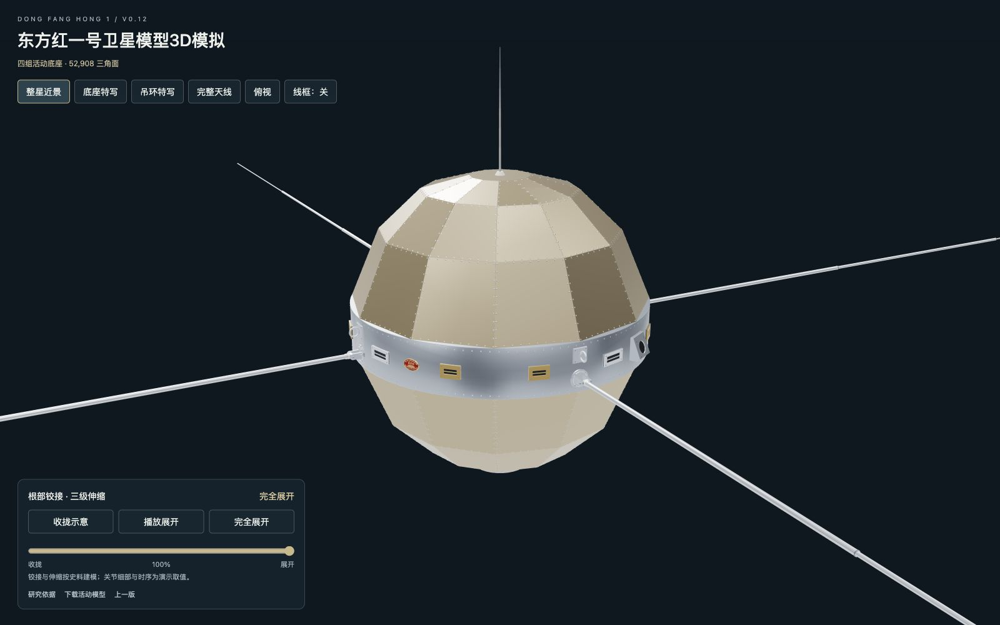

[← 返回作品集](../../README.md)

# 004 · 东方红一号

**文水十作品 · 航天器模型 / Blender 建模 / 交互式 3D 展示 · V12**

从历史照片和外观参考出发，在 Blender 中重建东方红一号的多面球壳、环形腰带与天线系统，再把模型放进可以旋转、缩放和演示天线展开的三维软件里。制作从整体轮廓逐步深入到铭牌、传感器、铆钉与天线根座，重点调整腰带部件的形状、安装位置与连接关系。

## 从外形到可动结构

四组长天线采用根部铰接与三级套管结构，支持收拢、展开和进度拖动。腰带上的铭牌、槽式天线外观、地平仪与太阳角计经过多轮参照校正；铭牌保留文字和城楼图案，并重新整理平面与边框层次。

## 腰带与连接细节

吊装环竖直安装，根部嵌入底板；天线底座加厚固定耳板，并增加两侧短加强筋，同时保留活动部件的空间。软件展示模型与后续打印使用的结构母版分别保存，便于继续调整。

## 模型也能交互观察

配套制作的「东方红一号卫星模型3D模拟」提供整星、底座、吊环和俯视等观察方式，支持线框查看与天线展开演示。通过清理不可见的铆钉背面，将软件模型从 **62,412 减至 52,908 个三角面**，减少约 **15.23%**，保留外露轮廓与动画；GLB 文件约 **3.40 MB**。

| 项目 | 信息 |
| --- | --- |
| 制作工具 | Blender 5.0.1、Three.js |
| 展示版本 | V12 |
| 尺寸体系 | 米制母版，可按制作需求缩放 |
| 当前状态 | 数字模型与交互演示完成；打印结构已做加固设计，尚未实物试打 |

本页四张图片均为当前数字模型的实时渲染截图。具体关节构型与展开时序属于建模和演示取值。

---

**文水十作品 · Wenshuishi**

[返回作品集](../../README.md) · [展示与使用说明](../../NOTICE.md)
