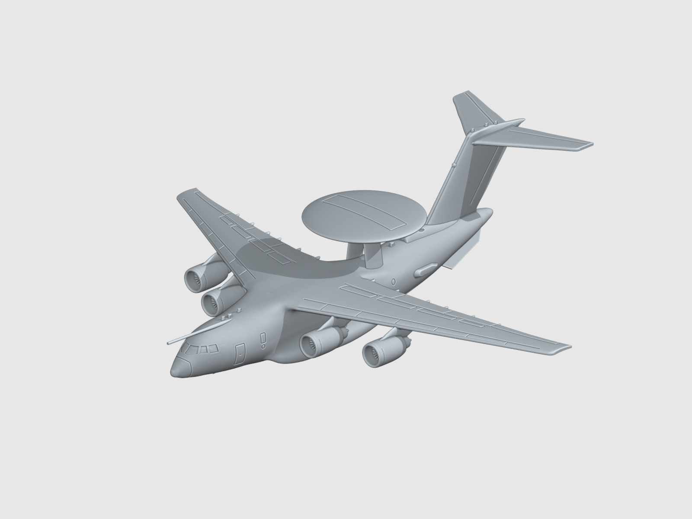
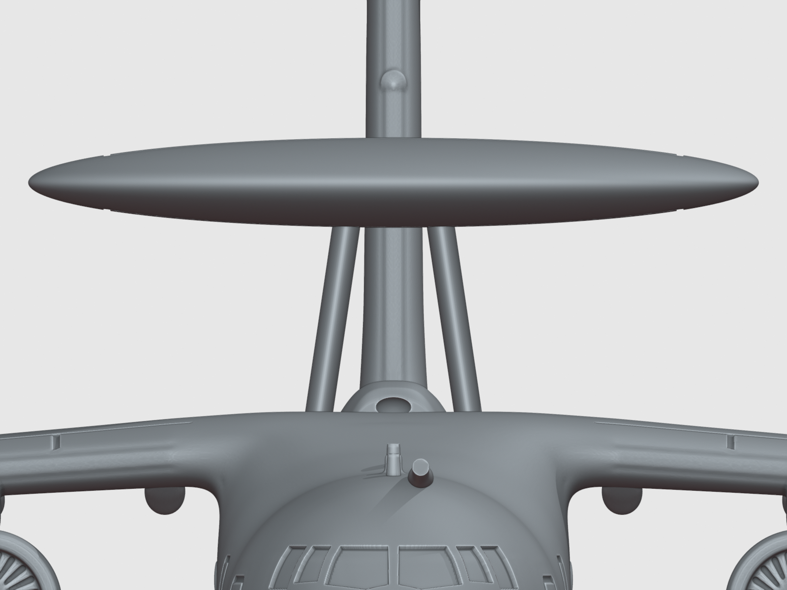
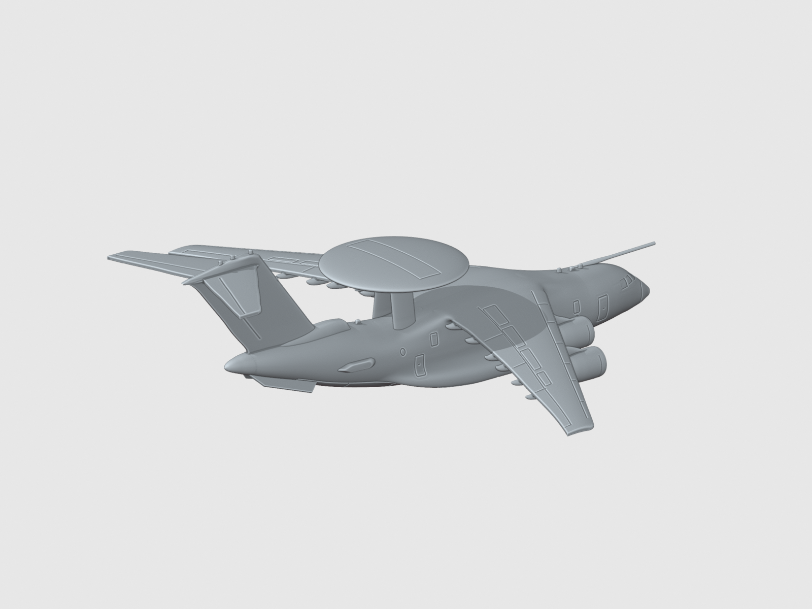
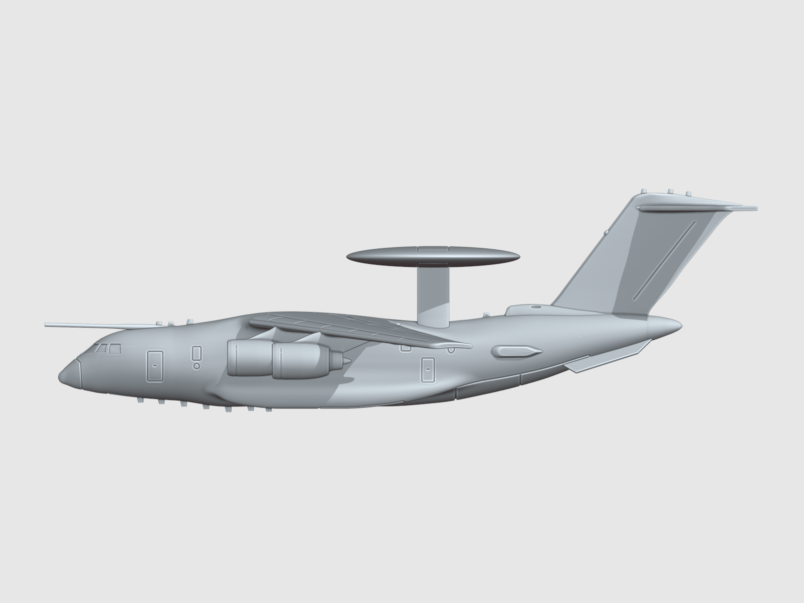
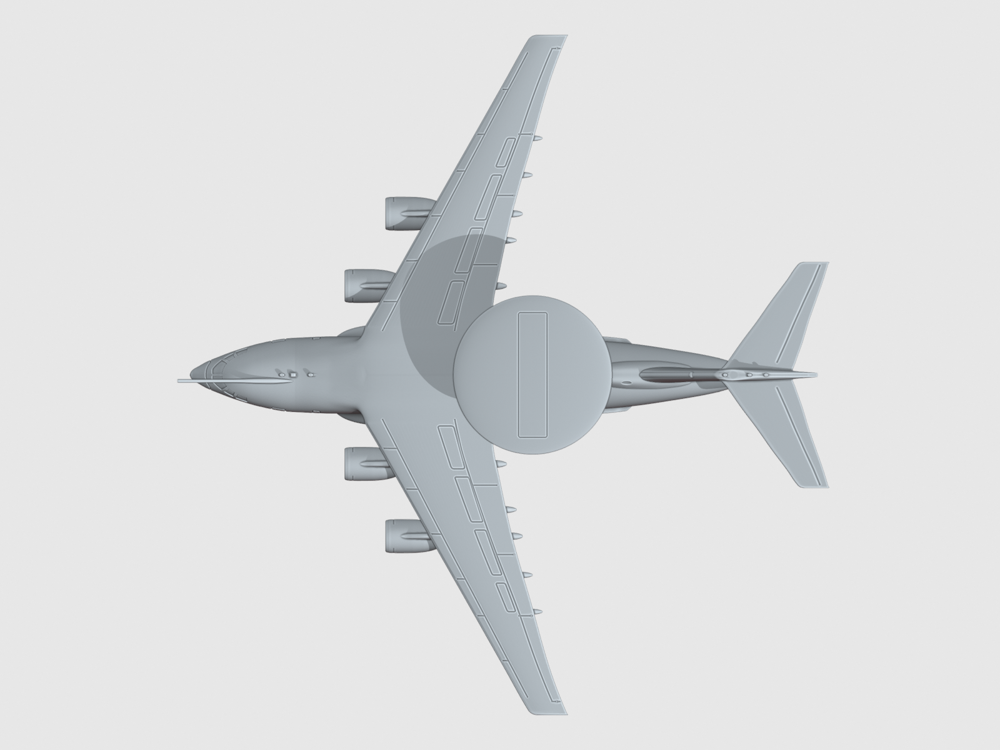
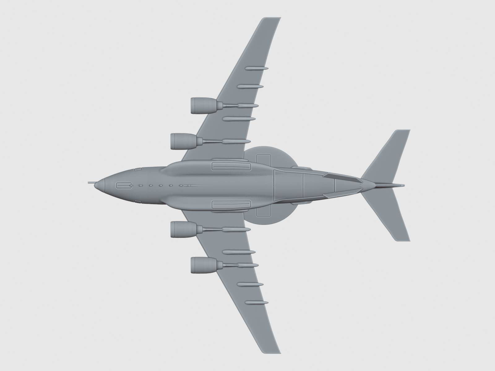
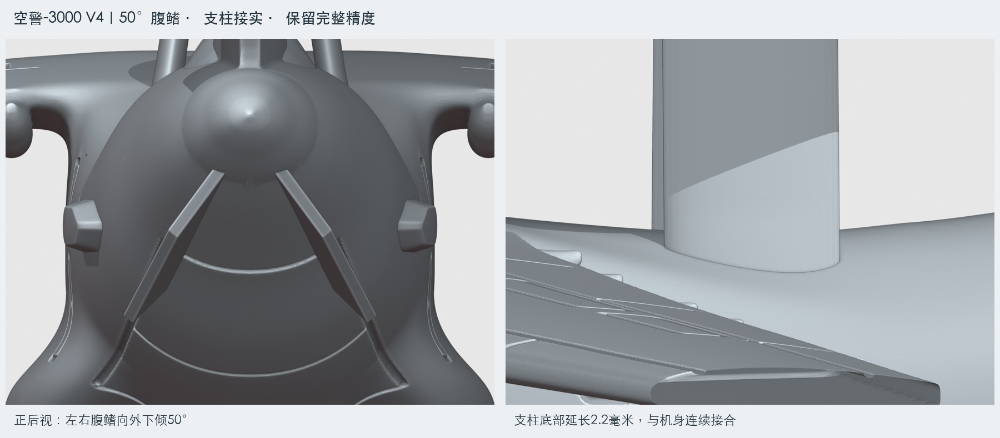
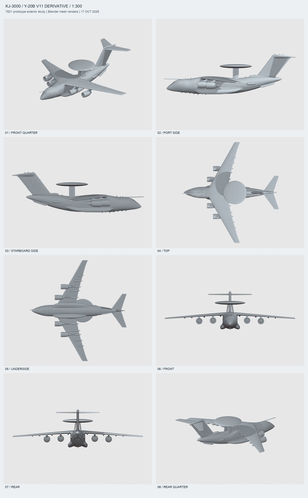

[← 返回作品集 / Back to the atelier](../../README.md)

# 003 · KJ-3000 空警-3000

**文水十作品 · Wenshuishi 3D Atelier · 1:300 · V4**

## 从运输机到预警机 / From transport to early warning aircraft

这件作品在运-20B V11 模型的基础上，重建空警-3000 **7821 原型机**的外观。保留四台发动机、高翼和 T 形尾翼的整体轮廓，再逐步处理圆形雷达罩、内倾支架、空中受油探管、机身天线整流罩、尾根结构、尾锥与双腹鳍。

制作的重点，是让新增部件与原有机体在形状、比例和连接处保持协调。雷达罩下方的两片支架、尾根整流过渡和机尾轮廓都经过多轮调整，再以多个角度检查整机与局部。

Built from the Y-20B V11 model, this work reconstructs the exterior of the KJ-3000 **7821 prototype**. It retains the four-engine, high-wing silhouette and T-tail, while adding the circular radome, inward-canted pylons, refueling probe, antenna fairings, tail-root structure, tail cone and paired ventral fins.

The focus was on fitting these additions into the aircraft’s proportions and surfaces. The radome supports, tail-root transitions and rear fuselage were refined through successive revisions and examined from multiple angles.

| 项目 / Item | 信息 / Details |
| --- | --- |
| 作品 / Work | KJ-3000 空警-3000 |
| 比例 / Scale | 1:300 |
| 模型尺寸 / Model dimensions | 约 / Approx. 159.7 × 166.7 × 50.0 mm（长 × 翼展 × 高 / length × span × height） |
| 构型 / Configuration | 7821 外观参考；静态整机、起落架收起 / 7821 exterior reference; static aircraft with landing gear retracted |
| 制作工具 / Tool | Blender 5.0.1 |
| 展示版本 / Displayed version | V4 |
| 当前状态 / Status | 数字模型与渲染；完成外观及几何审查，未实物试打 / Digital model and renders; appearance and geometry reviewed, not physically test-printed |

尺寸为本模型测量值。作品依据照片进行外观重建，并为小比例制作调整细节；不是原厂工程模型。本作保持 7821 构型，不加入 7822 的翼前机背进气道。

Dimensions are measured from this model. It is a photo-based exterior reconstruction with details adapted to a small scale, rather than a manufacturer’s engineering model. This work follows the 7821 configuration and omits the forward dorsal intake seen on 7822.

## 雷达罩与支架 / Radome and pylons

圆形雷达罩由两片向内倾斜的板形支架支撑。盘罩上下表面保留沿左右翼展方向布置的闭合矩形刻线；这些线条作为外观细节呈现，不据此推断内部雷达布置。

Two inward-canted plate-like pylons support the circular radome. Closed rectangular panel lines run across its upper and lower surfaces in the wingspan direction. These are exterior modeling details, not a claim about the internal radar arrangement.

## 尾部与整机轮廓 / Tail and overall silhouette

尾根低矮整流结构与垂尾衔接，机身两侧的天线整流罩采用平缓曲面，较短饱满的尾锥收束后机身。双腹鳍与这些部件一起，从后方形成区别于运输机基型的轮廓。

A low tail-root fairing joins the vertical stabilizer, shallow curved antenna fairings sit on the fuselage sides, and a short, full tail cone finishes the rear fuselage. Together with the paired ventral fins, these details distinguish the rear silhouette from the transport baseline.

<strong>展开：侧面、俯视与机腹 / Expand: side, top and underside</strong>

### 侧面 / Side

### 俯视 / Top

### 机腹 / Underside

## V4 制作记录 / V4 refinements

- **腹鳍角度：** 从正后方看，双腹鳍相对水平面向外下倾 **50°**，保留前后位置和 **0.65 mm** 法向厚度。
- **支柱连接：** 两根雷达支柱底部延长 **2.2 mm**，嵌入机身并消除悬空间隙，保留上方位置及内倾关系。
- **细节保留：** V4 保留完整几何精度，通过清理重复隐藏网格和重复交付文件缩小文件体积，没有对最终网格减面。

- **Fin angle:** Both fins angle outward and downward **50°** from horizontal in rear view, retaining their fore/aft position and **0.65 mm** normal thickness.
- **Pylon connection:** Both lower ends extend **2.2 mm** into the fuselage to close the gaps, while preserving their upper positions and inward cant.
- **Detail retention:** V4 retains the full geometry. File size was reduced by removing duplicate hidden meshes and redundant deliverables, without decimating the final mesh.

## 多角度检查 / Multi-angle inspection

两个独立审查代理分别检查外观与几何。最终网格为单一闭合连通实体，检查未发现非流形边、边界或退化面。V4 尚未重新进行数字切片，也没有完成实物试打；打印表面效果、强度与实际成型仍待验证。

Two independent review agents examined appearance and geometry. The final mesh is a single closed connected component, with no detected non-manifold edges, boundaries or degenerate faces. V4 has not been re-sliced or physically test-printed; printed surface quality, strength and fabrication results remain unverified.

本页全部图片均为 Blender 数字模型渲染，不是实物照片。

All images on this page are Blender renders of the digital model, not photographs of a physical print.

---

**文水十作品 · Wenshuishi**

本页展示图片与制作介绍，不提供模型或工程文件下载。 / This page presents images and making notes; model and project files are not distributed here.

[返回作品集 / Back to the atelier](../../README.md) · [展示与使用说明 / Usage notice](../../NOTICE.md)
