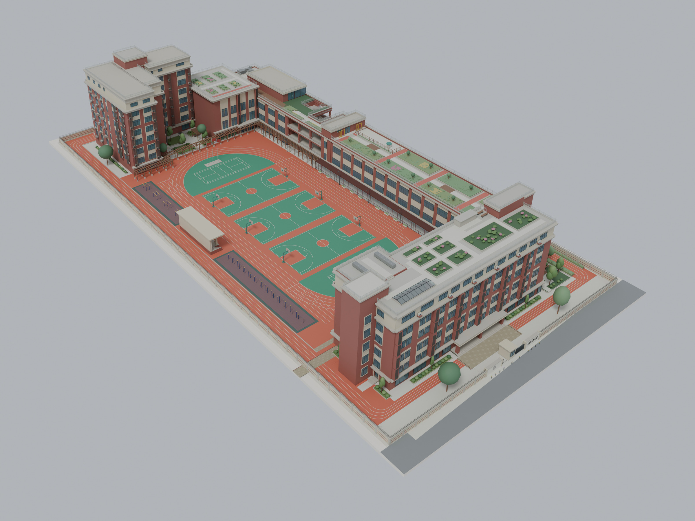
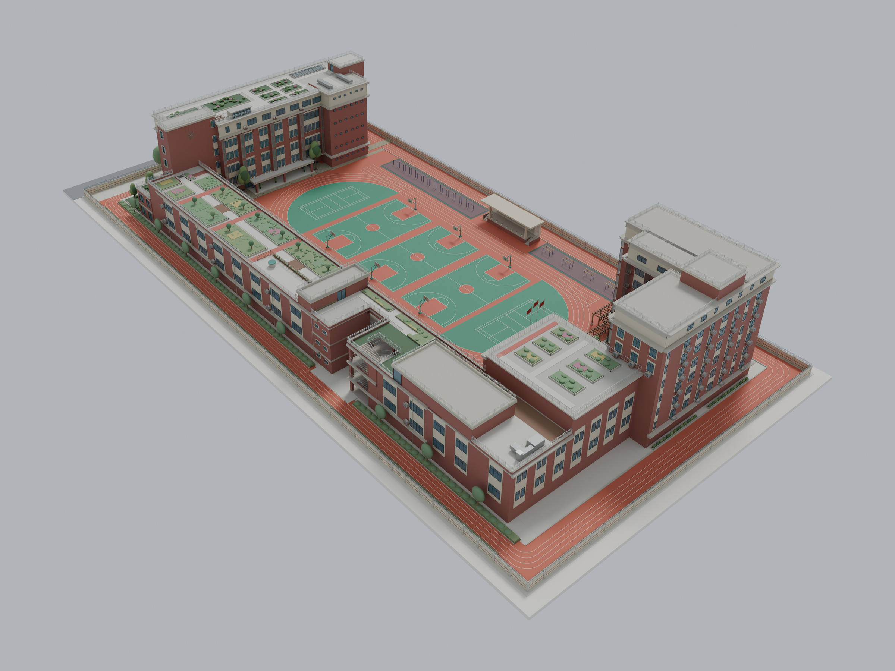
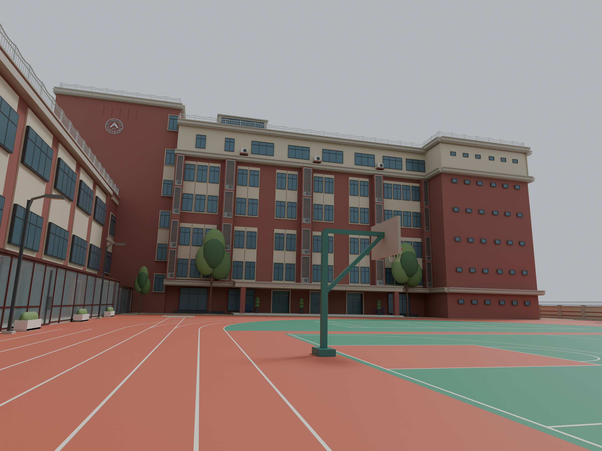
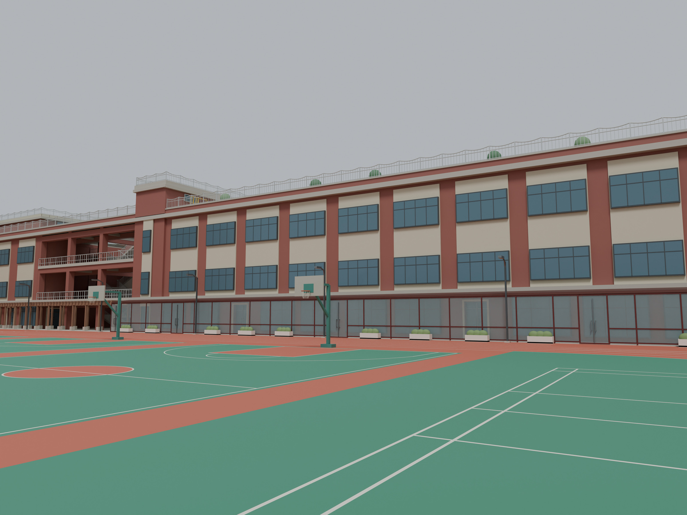
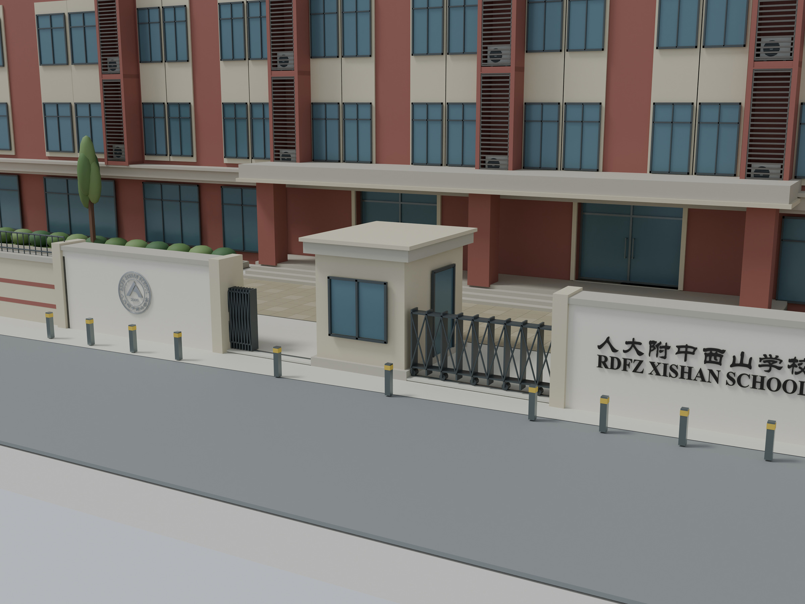
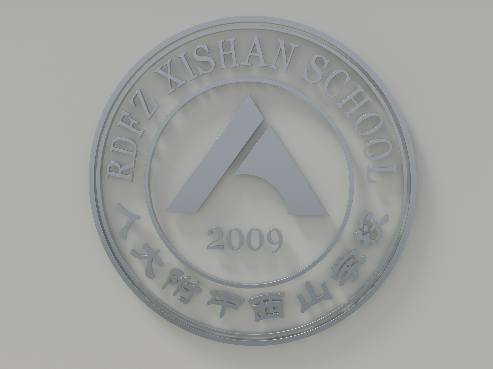
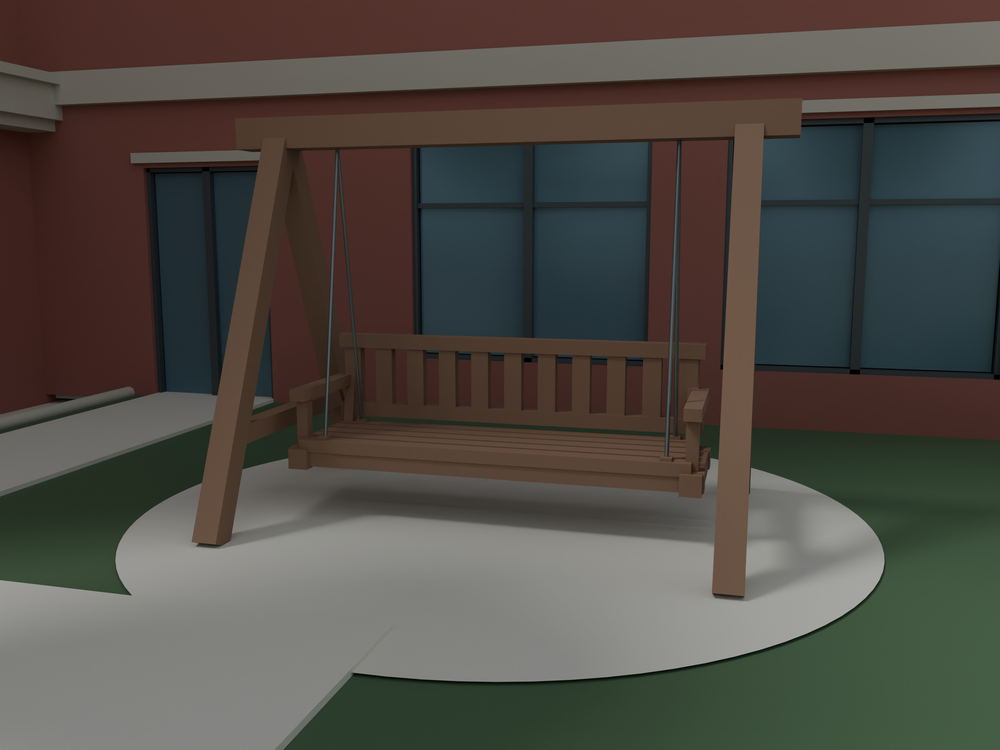
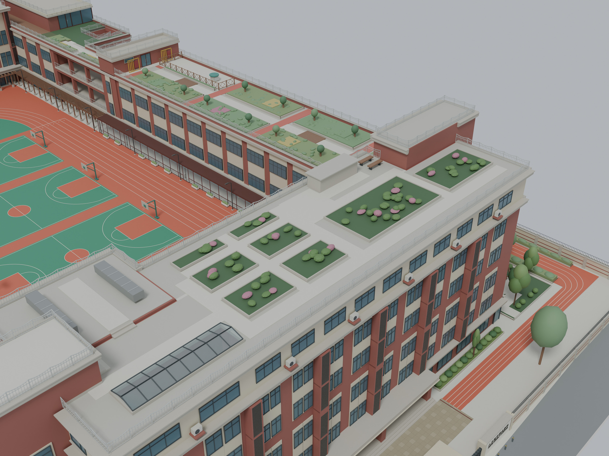
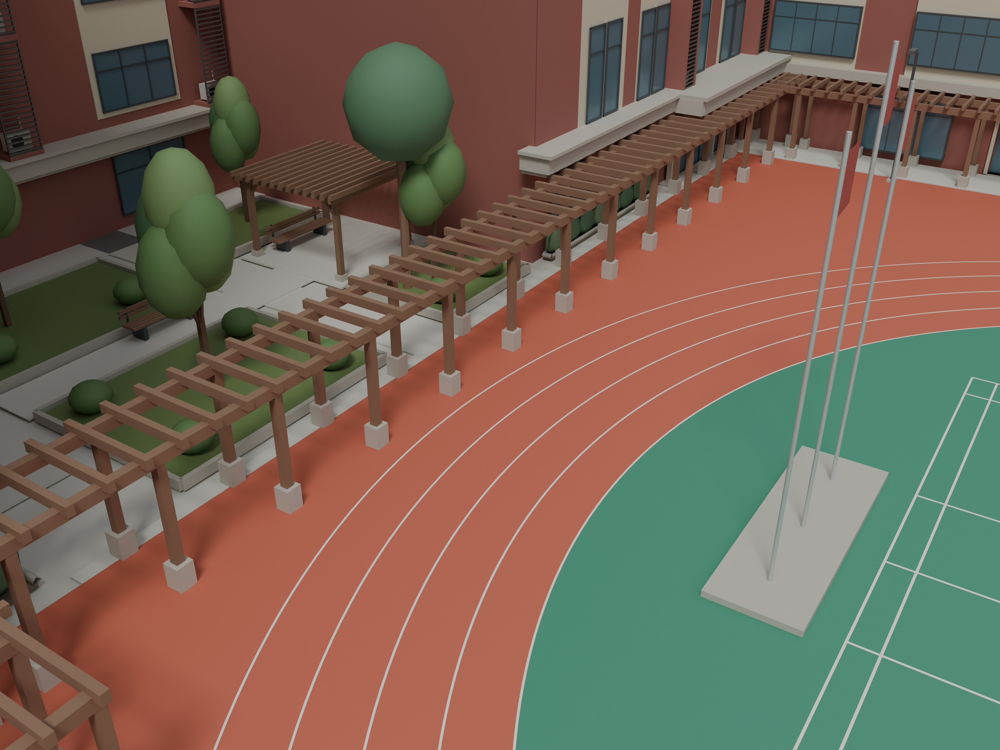

[← 返回文水十三维工坊 / Back to the atelier](../../README.md)

# 001 · 我们的西山 / Our Xishan

**文水十作品 · Wenshuishi · 校园建筑外观重建 · Blender · v1.8**

## 把记忆里的校园，重新建起来

这是我为人大附中西山学校制作的校园三维模型。起点是一个很简单的念头：把曾经每天经过的楼、操场和角落，再认真看一遍，也把它们留在一个可以从不同方向观看的空间里。

制作时，我对照实景照片、历史卫星影像和个人记忆，从南楼、东楼、北楼的整体关系开始，逐步补齐门厅、窗列、长廊、屋顶花园和运动场地。比起只做出一个相似的轮廓，我更在意从操场望向教学楼时，那种熟悉的空间关系能不能保留下来。

这份模型也成为《我们的西山》建造过程短片的基础：让校园从线稿与白模逐渐形成，再回到熟悉的日常视角。它是一份校园记忆，也是一份教师节礼物。

*A digital reconstruction of RDFZ Xishan School, built from photographs, historical satellite imagery and personal memories. The project preserves familiar views, from the school gate and playground to the rooftop gardens, and provides the scene for the film Our Xishan.*

| 项目 | 信息 |
|---|---|
| 作品名称 | 我们的西山 / Our Xishan |
| 题材 | 人大附中西山学校校园建筑与场地 |
| 制作工具 | Blender；Python 辅助场景构建与检查 |
| 展示模型 | v1.8 完整版 |
| 制作时间 | 2026 年 9 月 |
| 参考依据 | 实景照片、历史卫星影像与个人记忆 |
| 展示内容 | 校园整体、建筑立面、入口、花园及场地设施 |

本作是个人外观重建，尺寸与参考缺失处根据照片比例和空间关系推定，并非测绘或施工模型。本页全部图片均为数字模型渲染；图集统一采用 v1.8，不混入后续影片的季节与灯光版本。

## 从整体走进校园

南楼、东楼与北楼围绕操场展开。先处理建筑体量、层高与交接关系，再安排窗列、檐口、围栏和绿化，让各处细节属于同一个校园。

### 操场上的熟悉视角

南楼的红砖色立面、浅色窗框和向操场伸出的门厅，是这一侧的主要识别特征。

沿跑道看向东楼，连续的窗列和屋顶栏杆把视线带向校园深处。

### 从校门开始

入口与校名墙保留熟悉的尺度关系，也成为建造短片的开场位置。

<strong>展开：立体校徽</strong>

校徽的圆环、文字和中心图形拆分为立体构件，结合参考调整轮廓、字距和圆弧排布。

## 留住那些小地方

楼旁的一架秋千、树池和小路，让建筑之外也有值得停留的地方。

屋顶步道、种植区与附属建筑结合卫星影像和实景照片反复核对，同时保留必要的通行空间。

操场设施与周边长廊共同组成日常活动的背景，也让校园的整体比例更容易被辨认。

## 制作中的取舍

- **先确定空间关系。** 将南楼、转角连接体与东楼作为整体调整，结合不同高度的屋顶辨认卫星影像中的投影。
- **让构件有合理的连接。** 检查楼梯与平台、雨篷与柱子、栏杆与安装边界，避免只从一个镜头看起来成立。
- **多角度对照。** 在鸟瞰之外保留操场、入口和局部近景，反复核对熟悉的日常视角。
- **留下参考的不确定性。** 图片无法确认的地方采用合理简化，不把推定尺寸写成实测结果。

---

**文水十作品 · Wenshuishi**

本页发布作品介绍与精选渲染图，不提供模型、工程文件或参考照片下载。校园名称与校徽用于呈现重建对象，本作为个人创作。

[返回作品集](../../README.md) · [展示与使用说明](../../NOTICE.md)
