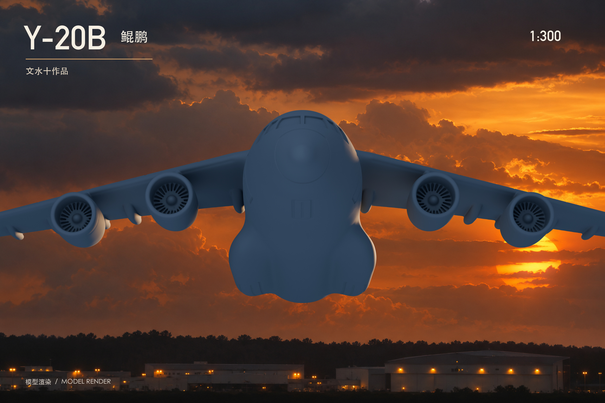
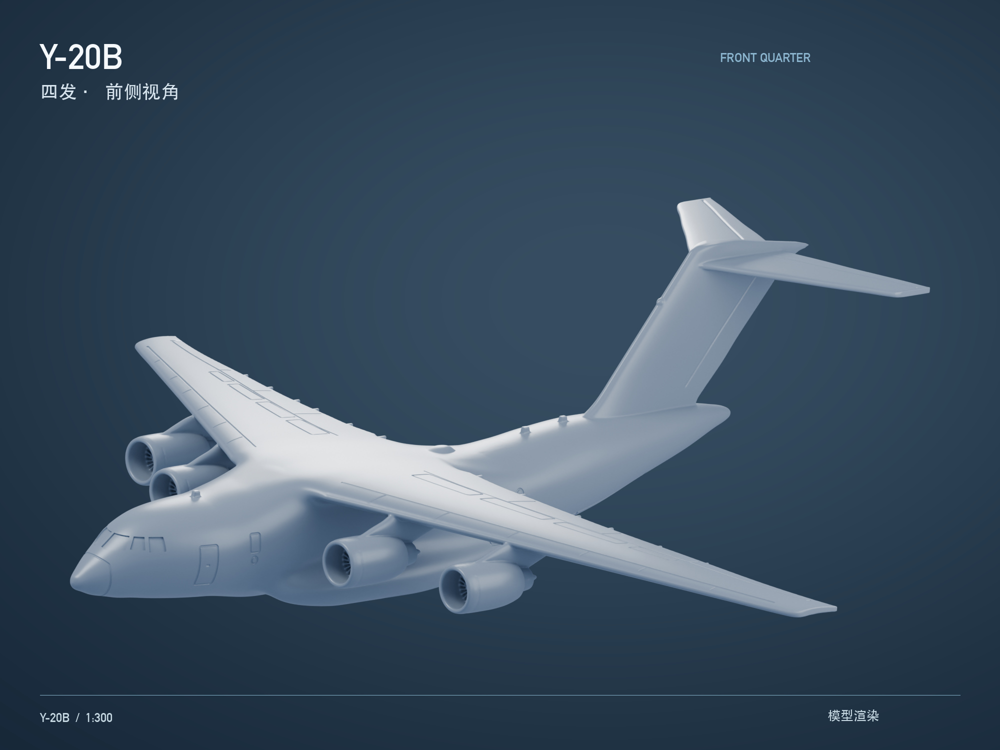
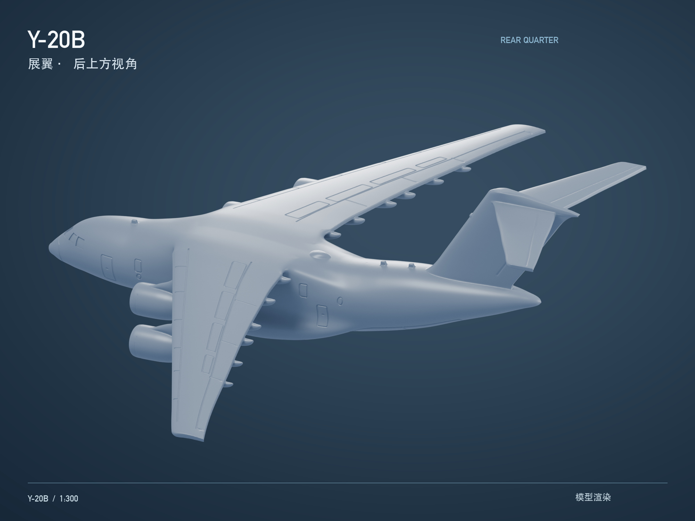
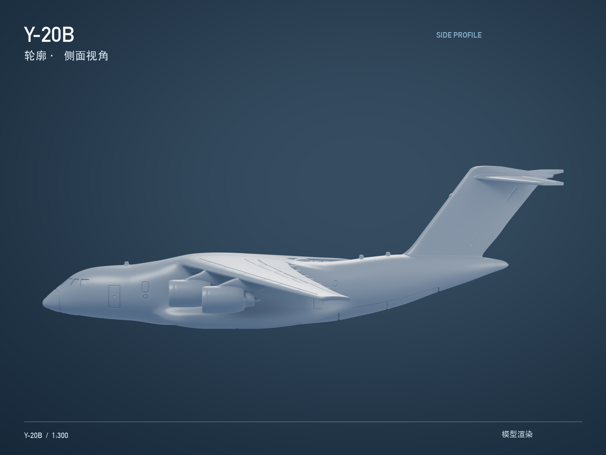
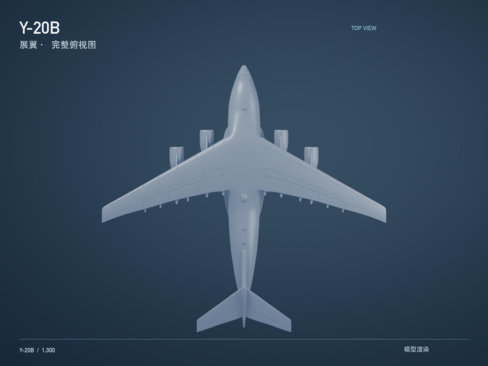
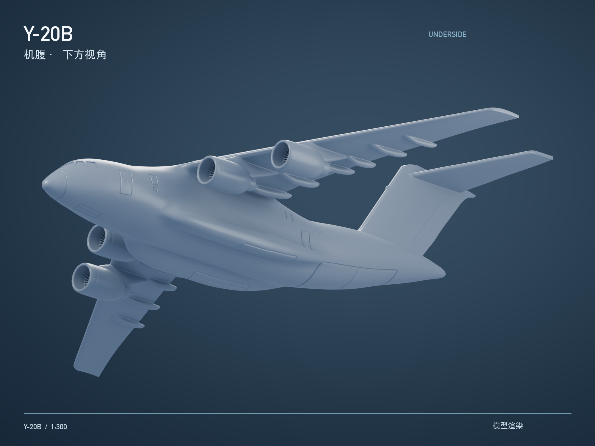
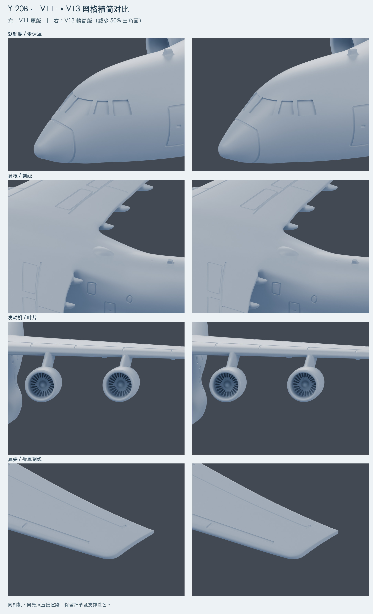

[← 返回文水十三维工坊](../../README.md)

# 002 · Y-20B 鲲鹏

**文水十作品 · 航空模型 · 1:300**

## 掌中的大型运输机

这件作品以 Y-20B 的外观为题材，把宽阔机翼、四发布局与高耸的 T 形尾翼浓缩到约 15.7 厘米的模型里。制作时反复对照不同角度的图片与三视图，重点调整翼身连接、机头驾驶舱、发动机和尾部轮廓。

我希望它既能在近景中呈现结构细节，也能在整机视角下保留大型运输机厚重、舒展的感觉。

| 项目 | 信息 |
|---|---|
| 作品名称 | Y-20B 鲲鹏 |
| 比例 | 1:300 |
| 模型尺寸 | 约 156.7 × 166.7 × 48.3 mm（长 × 翼展 × 高） |
| 构型 | 静态整机，起落架收起 |
| 制作工具 | Blender；Bambu Studio 用于切片验证 |
| 打印设计目标 | PLA、0.4 mm 喷嘴、0.12 mm 层高 |
| 当前状态 | 数字模型、渲染展示与数字验证；尚未完成实物试打验证 |

尺寸是本模型的实测数值。作品依据公开参考进行外观重建，并为小比例制作做了调整，不是原厂工程模型。

## 夕阳中的体量感

低机位仰视、长焦构图与夕阳逆光，用较暗的机腹和柔和的暖色轮廓光表现运输机的体量。此图为飞行氛围渲染，模型保持起落架收起构型。

## 从不同角度观察

### 前侧方 · 四发布局

机头、发动机短舱与主翼共同构成前部的视觉重心。

### 后上方 · 翼身融合与尾翼

主翼根部与机身连续过渡，后部整流外形向机身收尾，保留明确的轮廓转折。

<strong>展开：侧面、俯视与机腹</strong>

#### 侧面轮廓

#### 完整俯视

#### 机腹结构

## 制作过程 · 保留细节的网格精简

模型经历了翼根融合、驾驶舱窗形、雷达罩边界、翼尖过渡及机背天线等多轮调整。后续精简时，优先保护窗框、刻线、翼尖与发动机细节，把多余的网格从平缓区域减少。

*左为精简前，右为精简后；直接模型渲染，同相机、同光照。*

三角面由 **1,356,016 减到 678,008，减少 50%**。八角度检查未发现明显新增外观问题；双向共 72,000 个表面采样点中，最大测得偏差约 **0.0057 mm**。这是抽样结果，并非全模型误差的严格上限。

### 当前进度

- 已完成模型外观整理、网格闭合检查、多角度复核与数字切片验证。
- 已整理蓝天、夕阳与中性背景展示图。
- 实物试打效果、强度和表面细节仍待验证，后续有实拍时另行补充。

展示主图来自精简前的渲染阶段；末尾对比图记录精简前后变化。图片为数字模型渲染，部分氛围背景使用 AI 辅助生成与合成。

---

**文水十作品 · Wenshuishi**

[返回作品集](../../README.md) · [展示与使用说明](../../NOTICE.md)
